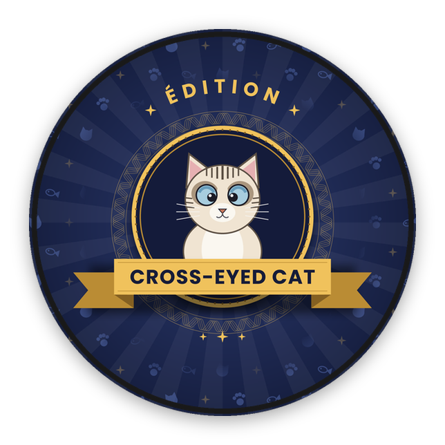
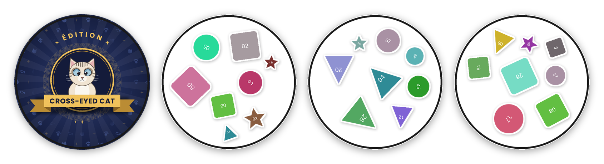

<p align="center">
  
</p>

<h1 align="center">OpenDobble — Édition Cross-Eyed Cat</h1>

<p align="center">
  
  
</p>

Générateur complet de jeu de type **Dobble / Spot It** : à partir de 57 images
(PNG, WebP ou JPG), il produit les 57 cartes du jeu et leur dos, prêts pour une
impression professionnelle recto-verso.

La répartition des symboles est construite mathématiquement à partir du
**plan projectif fini d'ordre 7** (jamais codée en dur) et validée
exhaustivement : deux cartes quelconques partagent exactement une image.

<p align="center">
  
</p>

## Fonctionnalités

- **Mathématiques** : plan projectif d'ordre 7 (57 cartes, 57 symboles,
  8 symboles/carte, intersection unique par paire), validé à chaque génération.
- **Placement intelligent** : spirale de tournesol + relaxation par forces +
  recuit simulé + phase de croissance qui comble les vides. Aucun
  chevauchement, aucune image collée au bord.
- **Rendu** : tailles variables (≈ 30 % grandes, 40 % moyennes, 30 % petites),
  rotation 0–360°, contour blanc automatique, ombre portée discrète.
- **Formats d'entrée** : PNG, WebP, JPG/JPEG, avec détourage automatique
  intelligent des sujets sur fond uni (photos et affiches conservées).
- **Dos de carte** : illustration « Édition Cross-Eyed Cat » fournie, et
  planches recto-verso avec verso en miroir.
- **5 thèmes** : `classic`, `pastel`, `dark`, `kids`, `minimal`.
- **Exports** : 57 PNG 300 dpi (fond transparent), 57 SVG, 1 PDF du deck,
  planches A4 (6 cartes/page) avec fonds perdus et traits de coupe.

## Installation

```bash
python -m venv .venv
source .venv/bin/activate        # Windows : .venv\Scripts\activate
pip install -r requirements.txt
```

Python 3.12 ou plus récent. Dépendances : Pillow, numpy, reportlab, svgwrite
(+ pytest pour les tests).

## Utilisation

Placez exactement **57 images** dans `images/` (l'ordre alphabétique des noms
définit l'identifiant du symbole), puis :

```bash
python main.py \
    --images images \
    --output output \
    --dpi 300 \
    --theme classic
```

Le dossier `images/` fourni contient 57 formes d'exemple
(`python tools/make_sample_images.py` pour les régénérer) : remplacez-les par
vos illustrations.

| Option            | Description                                            | Défaut          |
|-------------------|--------------------------------------------------------|-----------------|
| `--images`        | Dossier des 57 images sources                          | `images`        |
| `--output`        | Dossier de sortie                                      | `output`        |
| `--dpi`           | Résolution des exports                                 | `300`           |
| `--theme`         | `classic` `pastel` `dark` `kids` `minimal`             | `classic`       |
| `--seed`          | Graine aléatoire (rendu reproductible)                 | aléatoire       |
| `--back`          | Illustration du dos (active le recto-verso)            | `assets/back.*` |
| `--back-mode`     | `cover` (remplit le disque) ou `fit` (entière)         | `cover`         |
| `--bg-removal`    | Détourage : `auto` `always` `never`                    | `auto`          |
| `--bg-tolerance`  | Tolérance de couleur du détourage (0-255)              | `40`            |
| `--corner-radius` | Arrondi des images conservées rectangulaires           | `0.08`          |
| `--assets`        | Dossier des ressources (`background.png`, `back.png`)  | `assets`        |
| `--verbose`       | Logs de debug                                          | off             |

### Images sans transparence (JPG, WebP opaque)

En mode `auto`, seules les images qui ressemblent vraiment à un sujet sur fond
uni sont détourées (bordure homogène, proportion de fond retirée raisonnable).
Les photos, affiches, drapeaux, pochettes et logos pleine page sont conservés
tels quels, avec de légers coins arrondis. Contrôle par image, prioritaire :
`014.keep.jpg` n'est jamais détouré, `046.cut.jpg` l'est toujours.

### Dos de carte et impression recto-verso

`assets/back.png` (illustration « Édition Cross-Eyed Cat ») est détecté
automatiquement. Chaque planche devient un PDF de deux pages : les faces, puis
les dos placés en **miroir horizontal**. Imprimez en recto-verso,
**retournement sur le bord long** : chaque dos tombe sur sa face, y compris
sur la dernière planche incomplète. Sans dos, les planches restent recto seul.

Pour régénérer ou décliner l'illustration :

```bash
python tools/make_back.py                  # -> assets/back.png (2400 px)
python tools/make_back.py -o dos.png --size 3000
```

Couleurs dans la dataclass `Palette`, textes et proportions dans `compose()`.
Le visuel est pensé pour l'impression : motif régulier qui pardonne le léger
décalage recto/verso, et toute l'information tient dans 42 % du rayon pour
rester visible une fois la carte rognée en disque.

## Sorties

```
output/
    png/card_01.png … card_57.png       # 300 dpi, fond transparent
    png/back.png                        # dos de carte
    svg/card_01.svg … card_57.svg       # dimensions physiques exactes
    deck.pdf                            # 57 cartes, une par page
    sheets/sheet_01.pdf … sheet_10.pdf  # planches A4 recto-verso
```

## Configuration

Tous les paramètres sont regroupés dans `generator/config.py` sous forme de
dataclasses gelées : `CardConfig` (diamètre, marges, fond perdu),
`LayoutConfig` (distribution des tailles, rotation, espacement, itérations),
`ImportConfig` (formats, détourage), `BackConfig` (dos), `ExportConfig`
(résolution, cartes par planche, traits de coupe) et les thèmes.

## Tests

```bash
python -m pytest tests/ -v
```

## Architecture

```
OpenDobble/
    main.py                     # CLI et orchestration
    generator/
        config.py               # dataclasses de configuration + thèmes
        cards.py                # plan projectif d'ordre 7 + validation
        geometry.py             # primitives cercle / conteneur / spirale
        layout.py               # moteur de placement
        renderer.py             # rendu Pillow (contour, ombre, liseré, dos)
        export.py               # PNG / SVG / PDF / planches A4
        utils.py                # logging, progression, import des images
    tools/
        make_back.py            # illustration du dos
        make_sample_images.py   # 57 images d'exemple
        make_docs_images.py     # visuels du README et aperçu social
    docs/images/                # visuels affichés sur GitHub
    assets/
        back.png                # dos « Édition Cross-Eyed Cat »
        fonts/                  # Poppins (SIL Open Font License 1.1)
    images/                     # vos 57 images sources
    output/                     # fichiers générés
    tests/                      # suite pytest
```

## Visuels du dépôt

Les images du README sont dans `docs/images/` et se régénèrent avec :

```bash
python main.py --images images --output output --dpi 150 --seed 7
python tools/make_docs_images.py --cards output/png
```

`docs/images/social-preview.png` (1280 × 640) est l'aperçu affiché quand le
lien du dépôt est partagé : téléversez-le dans **Settings → General → Social
preview** sur GitHub.

## Licences

Code sous licence MIT © 2026 Mathieu Ribes (voir `LICENSE`). La police
Poppins est distribuée sous SIL Open Font License 1.1 (voir
`assets/fonts/OFL.txt`).

## Avertissement

OpenDobble est un projet libre et non officiel, sans aucun lien avec Asmodee
ni Zygomatic, qui ne l'approuvent ni ne le soutiennent. Dobble et Spot It!
sont des marques déposées de leurs propriétaires respectifs ; elles ne sont
citées ici que pour décrire le type de jeu généré.
